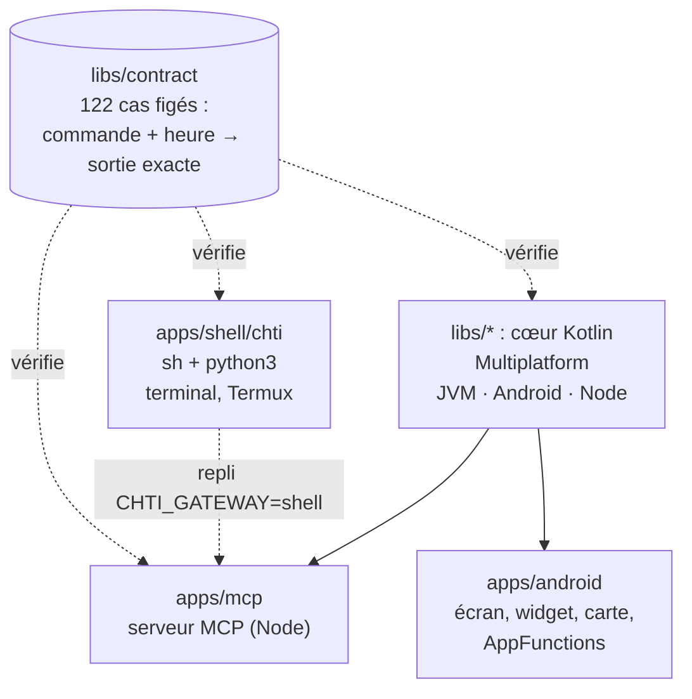

# 1. Premiers pas

> **Dans ce chapitre :** une réponse de Chtipasse dans ton terminal en deux minutes, puis l'appli
> sur ton téléphone, puis tous les tests au vert. À la fin, tu as un environnement complet et tu sais
> que rien n'est cassé.

## Le projet en une image

Chtipasse répond à une seule question, « quand passe mon bus ? », de plusieurs façons. Elles
partagent toutes la même logique, et un même jeu de tests les garde identiques :



Tu n'as pas besoin de tout installer pour commencer : chaque étape ci-dessous ajoute une brique.

## Étape 1 : une réponse en deux minutes (le script shell)

Il te faut seulement `curl`, `jq`, `unzip` et `python3`.

```sh
apps/shell/chti tram croise laroche vers roubaix
apps/shell/chti velo rihour
apps/shell/chti vocal "métro un république vers chu"
```

Le premier appel télécharge les horaires (environ 9 Mo) dans `~/.cache/chtipasse`. C'est tout :
tu viens d'utiliser l'implémentation de référence de Chtipasse. Toutes les commandes sont décrites
dans le [guide du terminal](../guide/terminal.md).

## Étape 2 : l'outillage du monorepo

Le dépôt est un monorepo [Nx](https://nx.dev) qui pilote à la fois Gradle (Kotlin, Android) et
Node (serveur MCP).

| Outil | Version | Pour quoi |
|---|---|---|
| Node | 24 ou plus | Nx et le serveur MCP (TypeScript exécuté directement, sans compilation) |
| JDK | 17 ou plus (`JAVA_HOME`) | Le cœur Kotlin et l'appli |
| SDK Android | via Android Studio (`ANDROID_HOME`) | L'appli et la cible Android du cœur |
| `shellcheck` | — | L'analyse du script shell |

```sh
npm install          # une fois : installe Nx et les dépendances du serveur MCP
npx nx graph         # le graphe des projets et de leurs dépendances, dans le navigateur
```

Les projets sont `shell`, `contract`, `mcp`, `:domain`, `:application`, `:presentation`,
`:adapters`, `:node`, `:core-tests` et `:android`. Ceux qui commencent par `:` sont des modules
Gradle.

## Étape 3 : construire l'appli Android

```sh
npx nx run :android:assembleDebug                                          # construit l'APK
adb install -r apps/android/build/outputs/apk/debug/android-debug.apk      # téléphone en débogage USB ou Wi-Fi
```

L'appli demande Android 8.0 ou plus récent. Pour la comprendre de l'intérieur, voir le chapitre
[L'appli Android](06-appli-android.md).

## Étape 4 : tout vérifier en une commande

```sh
npx nx run-many -t lint test build
```

Cette commande lance, pour tous les projets : `shellcheck`, le typage TypeScript, les 122 cas du
contrat joués par le shell, le cœur Kotlin et le serveur MCP, les règles d'architecture, les tests
Termux simulés et la compilation. Nx saute ce qui n'a pas changé depuis la dernière fois.

**Tout doit être vert avant chaque commit.** Si un cas du contrat échoue, le chapitre
[Le contrat et les tests](04-contrat-et-tests.md#lire-un-échec) explique comment lire la
différence.

Tu peux aussi lancer une seule partie :

```sh
apps/shell/tests/contract.sh             # le contrat, joué par le shell (~20 s, hors ligne)
./gradlew :core-tests:test               # le contrat et l'architecture, côté Kotlin
npx nx run-many -t lint test -p mcp      # le serveur MCP
```

---

**Et ensuite →** [2. L'architecture](02-architecture.md) : pourquoi trois implémentations, et le
trajet d'une question, du micro jusqu'à la réponse.
