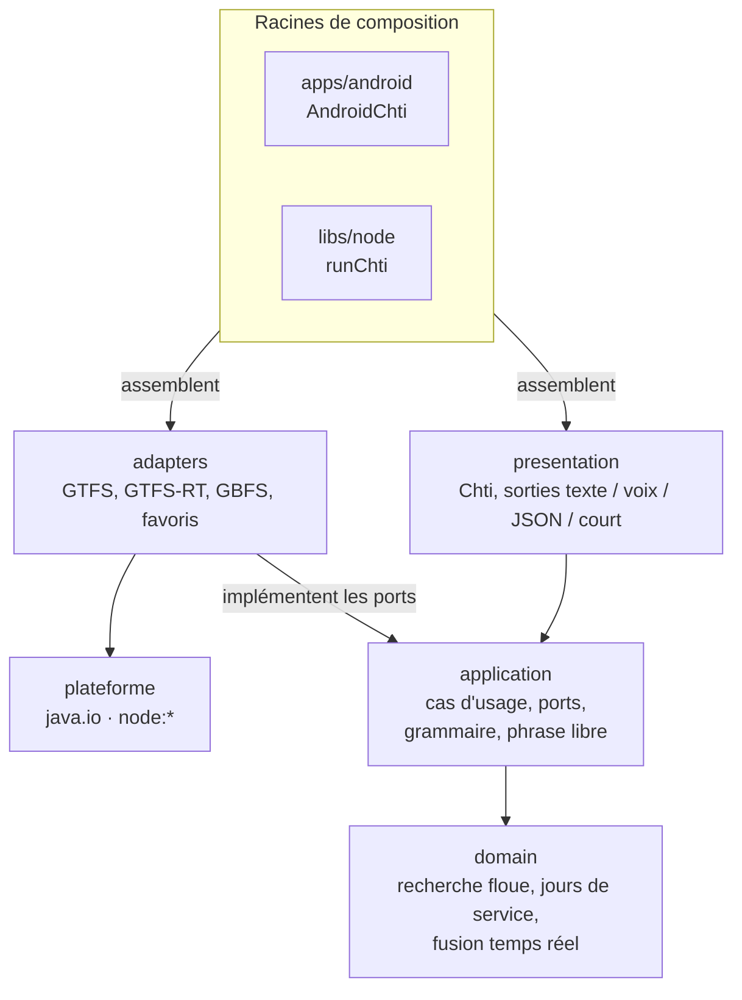
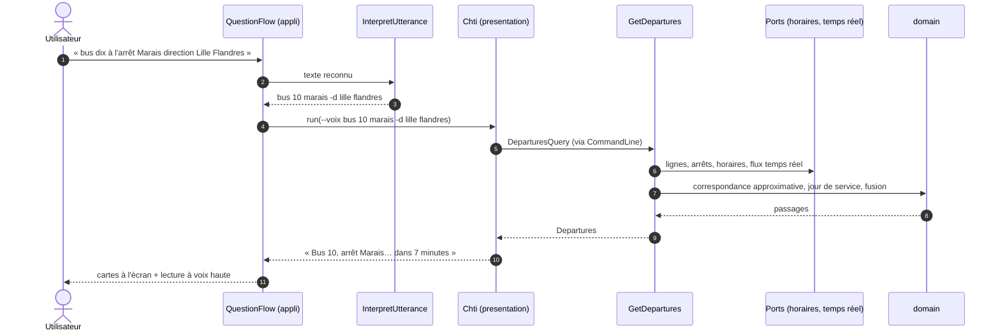

# 2. L'architecture

> **Dans ce chapitre :** pourquoi Chtipasse existe en trois implémentations sans jamais diverger,
> comment le cœur Kotlin est découpé, et ce qui se passe entre « bus dix à Marais » et
> « dans 7 minutes ».

## Une spécification exécutable plutôt qu'un document

Chtipasse est né comme un script shell. Quand il a fallu une appli Android puis un serveur pour les
assistants IA, réécrire la logique ailleurs faisait courir un risque : deux versions qui ne
répondent plus la même chose.

La réponse du projet tient en une règle : **le comportement est défini par des exemples, pas par du
code.** `libs/contract` contient 122 cas. Chacun associe une commande et une heure figée à la sortie
exacte attendue. Toute implémentation doit les reproduire **au caractère près** :

| Implémentation | Exécuteur du contrat |
|---|---|
| Script shell `apps/shell/chti` | `apps/shell/tests/contract.sh` |
| Cœur Kotlin `libs/*` | `libs/core-tests` (`ContractTest`) |
| Serveur MCP `apps/mcp` | `apps/mcp/test/contract.test.ts` (cas `json-*`) |

Une nouvelle fonctionnalité commence donc toujours par ses cas. Le chapitre
[Le contrat et les tests](04-contrat-et-tests.md) détaille le fonctionnement.

## Le cœur Kotlin, en architecture hexagonale

Le cœur est écrit en Kotlin Multiplatform et compile pour la JVM, Android et Node.js. Il est
découpé en couches, et chaque couche ne connaît que celles du dessous :

Les flèches indiquent qui dépend de qui : rien ne pointe jamais vers le haut.

Ces règles ne sont pas une simple convention : `libs/core-tests` (Konsist) fait échouer le build si
une couche importe ce qu'elle ne devrait pas. Le détail des modules est au chapitre
[Le cœur Kotlin](05-coeur-kotlin.md).

## Le trajet d'une question

Suivons « quand passe le bus dix à l'arrêt Marais direction Lille Flandres », dite dans l'appli
Android :

En détail :

1. **Écoute** (`apps/android/.../QuestionFlow.kt`) : la reconnaissance vocale du téléphone rend
   le texte.
2. **Compréhension** (`libs/application/.../InterpretUtterance.kt`) : la phrase devient les mots
   d'une commande, `bus 10 marais -d lille flandres`. Les mots d'introduction sont retirés, « dix »
   devient `10`, et « direction » ouvre la direction.
3. **Grammaire** (`CommandLine.kt`) : les mots deviennent une requête typée (`DeparturesQuery`).
4. **Cas d'usage** (`GetDepartures.kt`) : il trouve la ligne, puis l'arrêt (correspondance
   approximative du domaine), puis les directions. Il lit les horaires par le port
   `TimetableRepository` et le temps réel par le port `RealtimeFeed`.
5. **Domaine** (`libs/domain`) : il calcule le jour de service (un service qui continue après
   minuit appartient à la veille) et fusionne le théorique avec le temps réel, en propageant le
   retard aux arrêts suivants.
6. **Présentation** (`libs/presentation/.../Chti.kt`) : le résultat est mis en forme selon le mode
   demandé : texte du terminal, phrases à lire (`--voix`), JSON du contrat (`--json`) ou format
   compact à pictos pour les notifications (`--court`, propre au cœur Kotlin).
7. **Retour à l'appli** : la réponse s'affiche en cartes et elle est lue à voix haute, puisque la
   question a été dite.

Le widget, les raccourcis, les AppFunctions et le serveur MCP empruntent exactement le même chemin
à partir de l'étape 3 : ils construisent directement les arguments de la commande.

## Ce qui est propre à chaque plateforme

Presque rien. Le décodage CSV, protobuf, JSON et zip ainsi que le cache GTFS sont écrits une seule
fois, en Kotlin commun. Seul l'accès au système change :

- **JVM et Android** (source set `jvmShared`) : `java.io` et `java.net` ;
- **Node** : les modules `node:*`. Le téléchargement passe par un processus `node` enfant, pour
  garder des ports synchrones.

Le réseau lui-même est un profil (`NetworkProfile.kt`) : sources de données, fuseau horaire, lignes
sans temps réel. Le code reste générique GTFS, et Lille n'est qu'un profil, `ILEVIA`.

---

**Et ensuite →** [3. Les données](03-donnees.md) : d'où viennent les horaires, et ce qu'on peut (ou
ne peut pas) en tirer.
