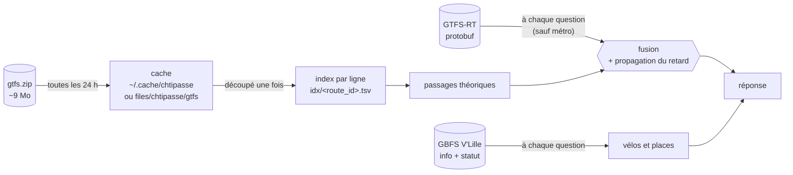

# 3. Les données

> **Dans ce chapitre :** les quatre flux ouverts sur lesquels repose Chtipasse, comment ils sont
> mis en cache, et les limites qui en découlent. Tu sauras aussi les interroger à la main avec
> `curl`.

## Quatre flux, aucune clé d'API

| Donnée | URL | Format |
|---|---|---|
| Référentiel lignes / arrêts / horaires | `https://media.ilevia.fr/opendata/gtfs.zip` | [GTFS](https://gtfs.org/schedule/) |
| Temps réel bus et tram | `https://proxy.transport.data.gouv.fr/resource/ilevia-lille-gtfs-rt` | [GTFS-Realtime](https://gtfs.org/realtime/) (protobuf) |
| Stations V'Lille | `https://media.ilevia.fr/opendata/station_information.json` | [GBFS](https://gbfs.org) 2.3 |
| Disponibilité V'Lille | `https://media.ilevia.fr/opendata/station_status.json` | GBFS 2.3 |

Ces URL sont définies une seule fois pour le cœur Kotlin, dans le profil `ILEVIA` de
`libs/application/.../NetworkProfile.kt`.

## Le chemin des données



## Le référentiel GTFS et son cache

Le GTFS (environ 9 Mo zippé) décrit tout le réseau : lignes (`routes.txt`), arrêts (`stops.txt`),
courses (`trips.txt`), horaires (`stop_times.txt`, environ 53 Mo) et calendrier
(`calendar_dates.txt`).

Le lire en entier à chaque question serait trop lent. Il est donc **découpé une fois en un index
par ligne** (`idx/<route_id>.tsv`), puis gardé en cache :

- dans `~/.cache/chtipasse` (ou `$XDG_CACHE_HOME/chtipasse`) pour `chti` et le serveur MCP. Le
  format est le même pour les deux, et le cache est partagé ;
- dans les fichiers privés de l'appli (`files/chtipasse/gtfs`) sur Android, sans `stop_times.txt`
  une fois l'index construit (44 Mo au total).

Le cache est **rafraîchi s'il a plus de 24 h**. Si le réseau est coupé, l'ancien cache sert, et un
nouvel essai a lieu au plus une fois par heure. Sur Android, une tâche WorkManager fait ce
rafraîchissement en arrière-plan (Wi-Fi, batterie suffisante), et le référentiel reste en mémoire
tant que l'appli tourne (`CachedTimetable.kt`).

## Le temps réel

Le flux GTFS-RT est du protobuf binaire, illisible avec `jq`. D'où un petit décodeur Python dans
`chti`, et un décodeur Kotlin dans `libs/adapters/.../realtime/GtfsRealtime.kt`.

Le flux ne détaille que les **prochains arrêts** de chaque course. Pour les arrêts suivants, le
dernier retard connu est propagé : c'est le comportement standard GTFS-RT. Une course sans suivi
temps réel est affichée en théorique, et elle est marquée comme telle.

## Les limites, assumées

- **Métro (M1, M2)** : aucun temps réel n'est publié en open data, donc seuls les passages
  théoriques sont donnés. Le profil le sait (`linesWithoutRealtime`) et ne télécharge même pas le
  flux pour le métro.
- **Sans réseau** : les horaires théoriques du cache servent. V'Lille, en revanche, demande le
  réseau.
- **Distances « à proximité »** : elles sont calculées à vol d'oiseau, pas sur le trajet à pied.

## Interroger les flux à la main

V'Lille :

```sh
# Toutes les stations (id, nom, capacité, coordonnées)
curl -s https://media.ilevia.fr/opendata/station_information.json | jq '.data.stations[]'

# Retrouver l'id d'une station par son nom
curl -s https://media.ilevia.fr/opendata/station_information.json \
  | jq '.data.stations[] | select(.name | test("rihour"; "i")) | {station_id, name, capacity}'

# Disponibilité d'une station (ici id 10 = Rihour)
curl -s https://media.ilevia.fr/opendata/station_status.json \
  | jq '.data.stations[] | select(.station_id == "10") | {num_bikes_available, num_docks_available, is_renting, is_returning}'
```

Bus, tram, métro :

```sh
# Référentiel GTFS
curl -sL -o gtfs.zip https://media.ilevia.fr/opendata/gtfs.zip && unzip -o gtfs.zip -d gtfs

# Flux temps réel (binaire protobuf GTFS-RT)
curl -s -o ilevia.pb https://proxy.transport.data.gouv.fr/resource/ilevia-lille-gtfs-rt
```

Pour faire tes essais, travaille dans `./tmp` : ce dossier est ignoré par git.

---

**Et ensuite →** [4. Le contrat et les tests](04-contrat-et-tests.md) : comment tester un programme
dont la bonne réponse change chaque minute.
