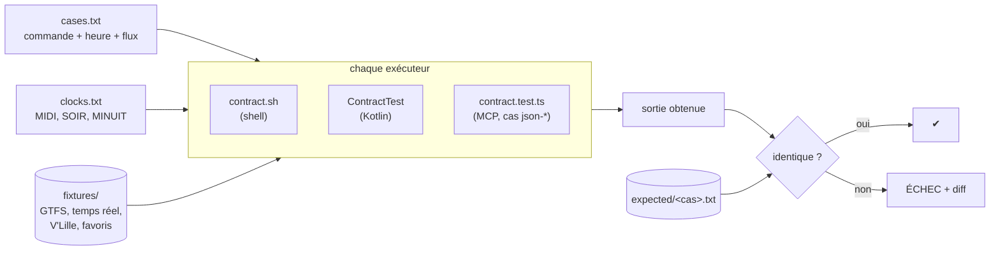

# 4. Le contrat et les tests

> **Dans ce chapitre :** comment on teste un programme dont la bonne réponse change chaque minute,
> comment lire un échec, et comment ajouter un cas. C'est le chapitre le plus utile avant ta
> première modification.

## Pourquoi des tests « figés » ?

Les horaires changent chaque minute : en lançant `chti bus 10 marais` à la main, impossible de
savoir si « 12:53 dans 7 min » est juste ou faux, puisque la bonne réponse change sans arrêt.
Les tests figent donc le monde :

1. **Données figées** : une copie des flux, enregistrée à un instant précis (`libs/contract/fixtures/`).
2. **Heure figée** : le programme croit qu'on est à cet instant-là (variable `CHTI_NOW`).
3. **Réponses de référence** : la sortie correcte de chaque commande, relue et enregistrée une fois
   pour toutes (`libs/contract/expected/<cas>.txt`).



Chaque exécuteur relance chaque commande dans ces conditions et compare sa sortie (stdout, stderr
et code retour) à la référence. Les mêmes entrées doivent toujours donner exactement la même sortie.

| Fichier | Rôle |
|---|---|
| `libs/contract/cases.txt` | Liste des cas (commande, heure, flux temps réel) |
| `libs/contract/clocks.txt` | Heures figées des cas |
| `libs/contract/fixtures/gtfs.zip` | Extrait du GTFS : lignes 10, tram et M1, du 10 au 12/10/2026 |
| `libs/contract/fixtures/rt-midi.pb`, `rt-minuit.pb` | Flux temps réel enregistrés le 10/10/2026 à 12:46 et le 11/10 à 00:00 |
| `libs/contract/fixtures/station_*.json` | Quelques stations V'Lille, dont une hors service |
| `libs/contract/fixtures/config/chtipasse/favoris` | Favoris de test |
| `libs/contract/expected/` | Sorties de référence, une par cas |
| `libs/contract/schema/response.schema.json` | Schéma JSON des réponses `--json` |
| `libs/contract/make_fixtures.py` | Régénère les fixtures à partir d'un nouvel instantané |

Le format précis des cas et des sorties est la référence de
[`libs/contract/README.md`](../../libs/contract/README.md).

**Ce que couvrent les 122 cas :** le temps réel avec propagation du retard, le passage de minuit,
le service du lendemain, un flux temps réel indisponible, la fin de service du métro, les filtres
`-d` et `-n` (y compris placés avant l'arrêt), le mot `vers`, le rapprochement approximatif des
arrêts et directions (fautes, phonétique, ex æquo proposés), `autour` (notations de la position,
filtre par mode, distances en m et km, erreurs), V'Lille (accents, plusieurs résultats, station
hors service, `--prendre` / `--deposer`), les favoris (liste, enchaînement, casse du nom, commande
en échec, favori inconnu), la sortie parlée `--voix`, la compréhension des phrases (`vocal`), la
sortie JSON `--json` et les messages d'erreur.

## Lancer les tests

```sh
npx nx run-many -t lint test build     # tout, avec le cache Nx
apps/shell/tests/contract.sh           # le contrat, joué par le shell (~20 s, hors ligne)
apps/shell/tests/termux.sh             # la partie Termux, avec des commandes simulées
apps/shell/tests/app-dir.sh            # reprise des dossiers d'avant le renommage (chtilevia → chtipasse)
./gradlew :core-tests:test             # le contrat et l'architecture, joués par le cœur Kotlin
npx nx run-many -t lint test -p mcp    # le serveur MCP : typage et contrat
```

## Lire un échec

Quand une sortie diffère de la référence, le cas est marqué `ÉCHEC` avec la différence :
`-` = ligne attendue absente, `+` = ligne en trop.

```
ÉCHEC bus-options-avant-arret  (chti bus 10 --nombre=2 --vers=chu marais)
      -10 — Eglise Du Marais  (EGLISE DU MARAIS 59160 LOMME)
      -  aucun passage prévu
      -
       10 — Marais  (LOMME MARAIS 59160 LOMME)
```

Deux situations possibles :

- **Régression** (la nouvelle sortie est fausse) : corrige le code, puis relance le test.
- **Changement voulu** (nouveau format d'affichage, correction de bug…) : régénère les références
  avec `apps/shell/tests/contract.sh --update`, puis **relis** `git diff libs/contract/expected/`.
  Seules les différences attendues doivent apparaître. `--update` enregistre la sortie actuelle
  telle quelle, même fausse : sans relecture, un bug deviendrait la référence.

## Ajouter un cas

1. Ajoute une ligne dans `libs/contract/cases.txt` (les apostrophes sont autorisées) :
   ```
   nom-du-cas | MIDI | rt-midi.pb | bus 10 gambetta -d flandres
   ```
   - **heure** : `MIDI` (10/10 12:46), `SOIR` (10/10 23:50) ou `MINUIT` (11/10 00:00), voir
     `libs/contract/clocks.txt` ;
   - **flux temps réel** : `rt-midi.pb`, `rt-minuit.pb`, ou `aucun` pour simuler un flux
     indisponible ;
   - **arguments** : ceux passés à `chti`. Seules les lignes 10, tram et M1 existent dans les
     fixtures.
2. Lance `apps/shell/tests/contract.sh --update`.
3. Relis `libs/contract/expected/nom-du-cas.txt` et vérifie que la sortie est juste.
4. Lance les exécuteurs Kotlin et MCP : ils jouent automatiquement le nouveau cas.
5. Commite le cas avec sa référence.

## Rejouer un cas à la main

Les variables utilisées par les tests servent aussi à reproduire un cas :

| Variable | Effet |
|---|---|
| `CHTI_NOW` | Heure courante figée (timestamp epoch) |
| `CHTI_GTFS_URL`, `CHTI_RT_URL`, `CHTI_GBFS_URL` | Sources de données (acceptent `file://`) |
| `XDG_CACHE_HOME` | Emplacement du cache (`$XDG_CACHE_HOME/chtipasse`) |
| `XDG_CONFIG_HOME` | Emplacement des favoris (`$XDG_CONFIG_HOME/chtipasse/favoris`) |

```sh
# Rejouer à la main le cas « bus-temps-reel », sans toucher au cache habituel
XDG_CACHE_HOME=/tmp/chti-test CHTI_NOW=1791629160 \
CHTI_GTFS_URL="file://$PWD/libs/contract/fixtures/gtfs.zip" \
CHTI_RT_URL="file://$PWD/libs/contract/fixtures/rt-midi.pb" \
apps/shell/chti bus 10 marais
```

Au premier lancement, le message « Mise à jour du référentiel GTFS… » s'affiche en plus, le temps
de construire le cache de test.

Pour tester le comportement hors ligne : `HTTPS_PROXY=http://127.0.0.1:9 apps/shell/chti bus 10 gambetta`
(le script doit retomber sur les horaires théoriques).

## Les tests Termux simulés

`apps/shell/tests/termux.sh` vérifie la partie Termux (`apps/shell/termux/`) sans téléphone. Il
crée un faux Termux dans un dossier temporaire, où `pkg`, `termux-speech-to-text`,
`termux-notification`, `termux-toast` et `termux-tts-speak` sont remplacés par de petites
imitations qui notent ce qu'on leur demande dans un journal.

Le test lance ensuite le vrai `apps/shell/termux/install.sh`, puis les vrais boutons du widget sur
les fixtures, et vérifie dans le journal ce qui aurait été affiché et lu à voix haute : *Parler*
doit répondre à la voix, les boutons de favoris par écrit et jamais à la voix. La phrase
« entendue » est fixée par la variable `FAKE_PHRASE`.

## Régénérer les fixtures

C'est rarement nécessaire, par exemple si Ilévia change le format de ses données. Les fixtures
doivent alors être recréées à partir d'un nouvel instantané :

```sh
mkdir -p tmp/raw && cd tmp/raw
curl -sL -o gtfs.zip https://media.ilevia.fr/opendata/gtfs.zip && unzip -o gtfs.zip
curl -s -o rt-midi.pb https://proxy.transport.data.gouv.fr/resource/ilevia-lille-gtfs-rt     # en journée
curl -s -o rt-minuit.pb https://proxy.transport.data.gouv.fr/resource/ilevia-lille-gtfs-rt   # vers minuit
curl -s -O https://media.ilevia.fr/opendata/station_information.json
curl -s -O https://media.ilevia.fr/opendata/station_status.json
cd ../..
python3 -I libs/contract/make_fixtures.py tmp/raw libs/contract/fixtures
```

Ensuite :

1. Adapte `DATES` dans `libs/contract/make_fixtures.py` aux jours de l'instantané, puis relance la
   commande ci-dessus.
2. Adapte `MIDI`, `SOIR` et `MINUIT` dans `libs/contract/clocks.txt` aux heures de capture
   (timestamp epoch, par exemple `date -j -f '%Y-%m-%d %H:%M:%S' '2026-10-10 12:46:00' +%s`).
3. Lance `apps/shell/tests/contract.sh --update` et relis **toutes** les références.

Les données brutes restent dans `tmp/` et ne sont pas versionnées.

---

**Et ensuite →** [5. Le cœur Kotlin](05-coeur-kotlin.md) : les modules, les cibles et le build.
