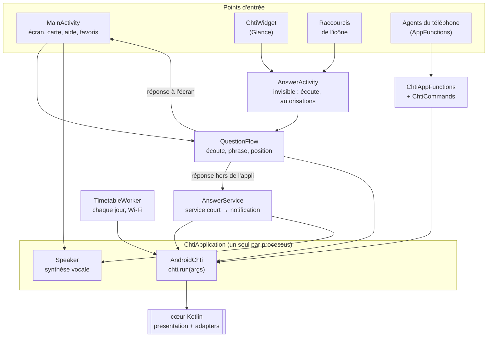

# 6. L'appli Android

> **Dans ce chapitre :** comment le cœur Kotlin devient un écran, un widget, des raccourcis et des
> fonctions pour les agents, et où chercher quand tu veux modifier l'un d'eux.

L'appli (`apps/android`, paquet `fr.chtipasse`) est écrite en Jetpack Compose et s'appuie
directement sur les modules `:presentation` et `:adapters`. Il n'y a aucun serveur : le cœur tourne
dans le processus de l'appli.

| | |
|---|---|
| `minSdk` / `targetSdk` | 26 (Android 8.0) / 37 |
| Interface | Compose Material 3, widget Glance |
| Arrière-plan | WorkManager (horaires), service court (widget) |
| Carte | MapLibre, style [OpenFreeMap](https://openfreemap.org) (données OpenStreetMap) |
| Agents | AppFunctions (Jetpack, expérimental, généré par KSP) |

## Construire et installer

```sh
npx nx run :android:assembleDebug
adb install -r apps/android/build/outputs/apk/debug/android-debug.apk
```

## Vue d'ensemble



## La carte des fichiers

| Fichier | Rôle |
|---|---|
| `ChtiApplication.kt` | Un seul cœur par processus (partagé par l'écran, le widget et les AppFunctions), réglages, tâche quotidienne des horaires |
| `AndroidChti.kt` | Racine de composition : le cœur avec les adaptateurs JVM, le référentiel dans `files/chtipasse/gtfs`, les favoris dans `files/chtipasse/favoris` |
| `MainActivity.kt`, `MainViewModel.kt` | Écran principal : micro, saisie, réponses en cartes, favoris, thème, navigation vers l'aide et la carte |
| `QuestionFlow.kt` | Une question, de l'écoute à la réponse : reconnaissance vocale, phrase comprise comme `chti vocal`, position si « à proximité », réponse |
| `AnswerCards.kt`, `Answers.kt` | Réponses en cartes et badges (temps réel / théorique) ; notifications de réponse |
| `Speaker.kt` | Synthèse vocale partagée : une réponse coupe la précédente |
| `FavoritesScreen.kt` | Création, modification, ordre et suppression des favoris, avec saisie assistée (`SuggestQuery`) |
| `MapScreen.kt`, `DeviceLocation.kt` | Carte MapLibre des arrêts et stations proches, filtres par mode, *Itinéraire* (lien `geo:`) ; position du téléphone |
| `Help.kt` | Page *Que demander ?* avec des exemples à toucher |
| `ChtiWidget.kt` | Widget Glance : *Parler* et un bouton par favori |
| `AnswerActivity.kt`, `AnswerService.kt` | Écran invisible (écoute, autorisations) puis service court qui répond en notification, sans ouvrir l'appli |
| `Shortcuts.kt` | Raccourcis de l'icône : *Parler* et un raccourci par favori |
| `TimetableWorker.kt` | Rafraîchit les horaires chaque jour (Wi-Fi, batterie suffisante) |
| `ChtiAppFunctions.kt`, `ChtiCommands.kt` | Fonctions exposées aux agents du téléphone et construction sûre des commandes |
| `Theme.kt` | Couleurs de la marque, thèmes clair et sombre |
| `Benchmark.kt` | Mesure du GTFS complet sur le téléphone |

## Les décisions qui comptent

- **Une commande, plusieurs formats.** Tout passe par `chti.run(args)`, avec `--voix` pour ce qui
  est lu, `--court` pour les notifications et `--json` pour les AppFunctions. L'appli n'a aucune
  logique de transport à elle.
- **La réponse suit la façon de demander.** Une question dite est lue à voix haute ; un bouton
  touché ou une question tapée reçoit une réponse écrite. Le réglage 🔊/🔇 coupe la voix partout.
- **Jamais d'attente réseau sur une question.** Le référentiel est rafraîchi en arrière-plan par
  WorkManager, et il est gardé en mémoire par `CachedTimetable` tant que l'appli tourne (moins d'un
  dixième de seconde par réponse). Une seule commande s'exécute à la fois, sur un fil dédié.
- **Le widget n'ouvre pas l'appli.** `AnswerService` est un service de premier plan de type
  `shortService` : Android le laisse vivre le temps de la réponse (3 minutes au plus).
- **Les favoris sont le même fichier que celui du shell** (`nom: commande`), et les commentaires sont
  conservés à l'enregistrement. Le widget et les raccourcis suivent le fichier.

## AppFunctions

`BaseChtiAppFunctionService` (dans `ChtiAppFunctions.kt`) déclare six fonctions :
`prochainsPassages`, `listerArrets`, `stationVelo`, `autourDeMoi`, `listerFavoris` et `favori`.
Elles prennent les mêmes paramètres que les outils MCP, et un test de `apps/mcp` vérifie cette
parité. KSP génère le service et le schéma lus par le système.

Chaque fonction répond en phrases à lire (`text`) et en JSON du contrat (`json`). Une erreur du
contrat devient l'exception AppFunctions adaptée (`ElementNotFound`, `InvalidArgument`…).
`ChtiCommands` construit les arguments comme le serveur MCP : un texte libre venant d'un agent ne
peut jamais devenir une option de `chti`.

Pour les essayer sans Gemini :

```sh
adb shell cmd app_function list-app-functions --package fr.chtipasse
adb shell "cmd app_function execute-app-function --package fr.chtipasse \
  --function 'fr.chtipasse.android.BaseChtiAppFunctionService#prochainsPassages' \
  --parameters '{\"mode\":\"tram\",\"arret\":\"croisé laroche\",\"direction\":\"roubaix\"}' --brief-yaml"
```

## Mesurer les performances sur un vrai téléphone

```sh
adb shell am start -n fr.chtipasse/.android.MainActivity --ez mesurer true
adb logcat -s chtipasse
```

`Benchmark.kt` mesure le téléchargement, la décompression et l'indexation du GTFS complet, la place
occupée, la mémoire et le temps de réponse de quelques commandes (première et seconde fois).

## Tester

La logique est testée dans le cœur (chapitres 4 et 5). Pour l'appli elle-même :

```sh
npx nx run :android:lint
npx nx run :android:assembleDebug
```

L'appli est utilisée au quotidien sur un Pixel (Android 17).

---

**Et ensuite →** [7. Le script shell](07-script-shell.md) : l'implémentation de référence, en un seul
fichier.
