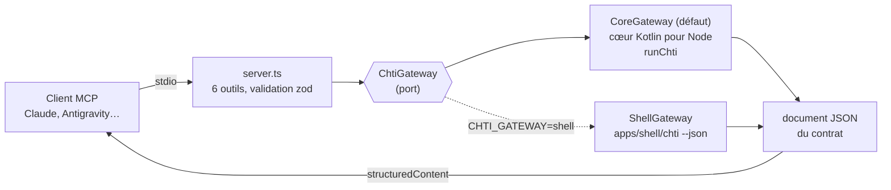

# 8. Le serveur MCP

> **Dans ce chapitre :** comment un assistant IA interroge Chtipasse, et pourquoi il ne peut pas lui
> faire faire n'importe quoi.

Le serveur (`apps/mcp`) expose six outils en lecture seule à tout client
[MCP](https://modelcontextprotocol.io) : `prochains_passages`, `lister_arrets`, `station_velo`,
`autour_de_moi`, `lister_favoris` et `favori`. Il tourne en local, en stdio, et il est écrit en
TypeScript exécuté directement par Node 24, sans étape de compilation.

L'installation côté utilisateur (Claude Code, Claude Desktop, Antigravity) est décrite dans
[Assistants IA](../guide/assistants-ia.md). La référence technique (outils, paramètres,
architecture, variables d'environnement) est dans
[`apps/mcp/README.md`](../../apps/mcp/README.md).



## L'essentiel en trois idées

1. **Un port, deux passerelles.** Le serveur ne connaît que `ChtiGateway`. La passerelle par
   défaut appelle le cœur Kotlin compilé pour Node (`runChti`). Elle garde le référentiel en mémoire
   et, au démarrage, le met à jour en tâche de fond s'il a plus de 24 h (`prepareTimetable`, dans un
   `node` enfant). La passerelle de secours lance le script `chti --json`. Les deux rendent les mêmes
   documents.
2. **Le contrat comme schéma de sortie.** Chaque réponse est un document de
   `libs/contract/schema/response.schema.json`, renvoyé en `structuredContent`. Ce même schéma sert
   d'`outputSchema` aux outils.
3. **Des garde-fous plutôt qu'un shell.** Un texte reçu ne peut pas commencer par `-` (aucune
   option de `chti` ne peut être injectée). L'arrêt et la direction sont passés d'un seul tenant.
   `favori` n'accepte qu'un nom présent dans la liste des favoris.

## Parité avec les AppFunctions

Les AppFunctions de l'appli Android ([chapitre 6](06-appli-android.md#appfunctions)) exposent les
mêmes outils, avec les mêmes paramètres. `apps/mcp/test/appfunctions.test.ts` vérifie cette parité :
ajouter un outil d'un côté sans l'autre fait échouer les tests.

## Tester

```sh
npx nx run-many -t lint test -p mcp                      # typage + tests (les deux passerelles)
npx @modelcontextprotocol/inspector node apps/mcp/src/main.ts   # essayer les outils à la main
```

`test/contract.test.ts` relie un client MCP au serveur en mémoire et vérifie que chaque appel
d'outil rend **exactement** le document d'un cas `json-*` du contrat.

---

**Et ensuite →** [9. Contribuer](09-contribuer.md) : les conventions, et la recette pour ajouter une
fonctionnalité de bout en bout.
